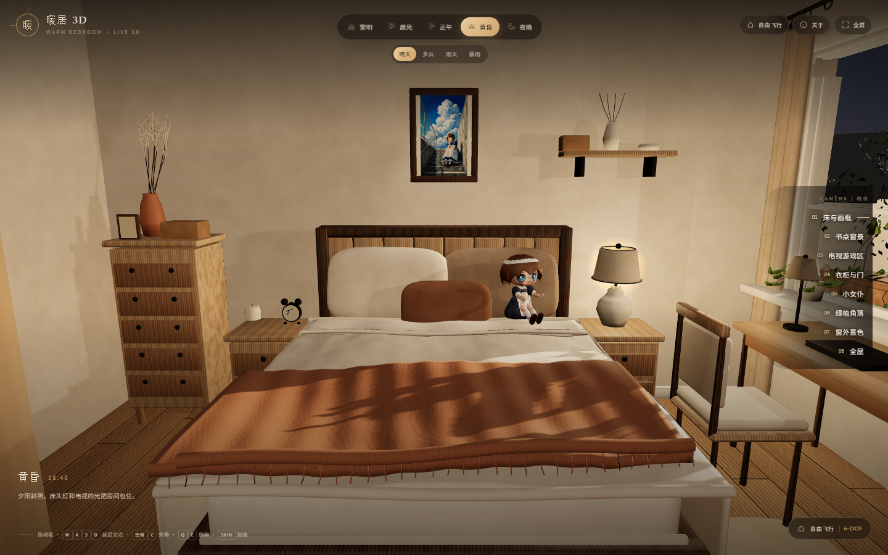
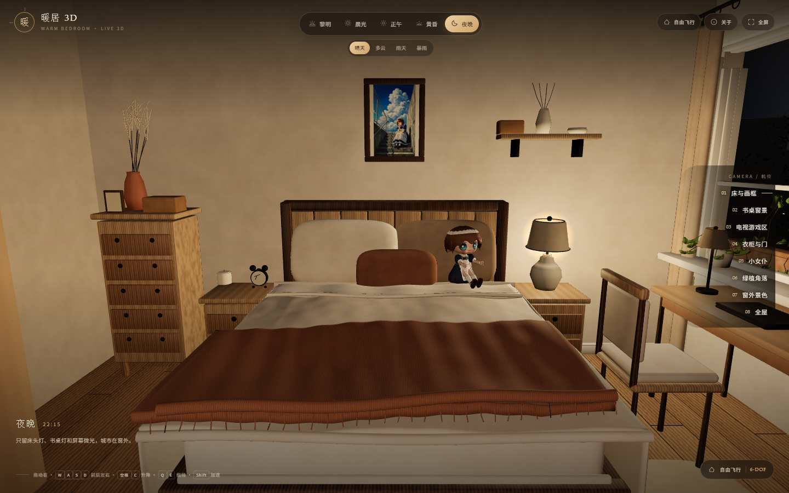
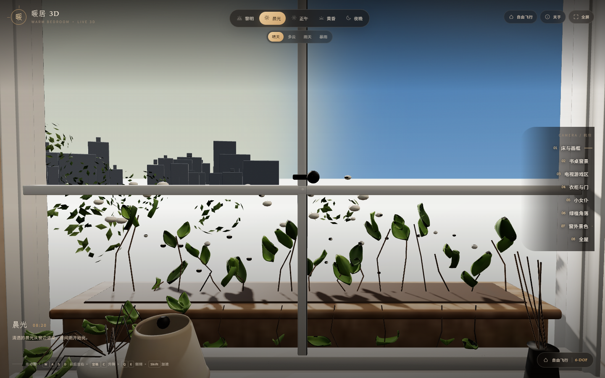
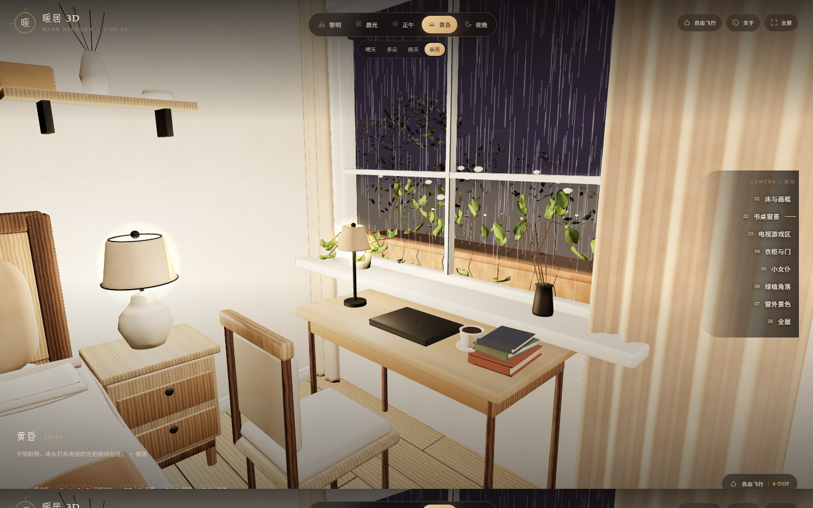
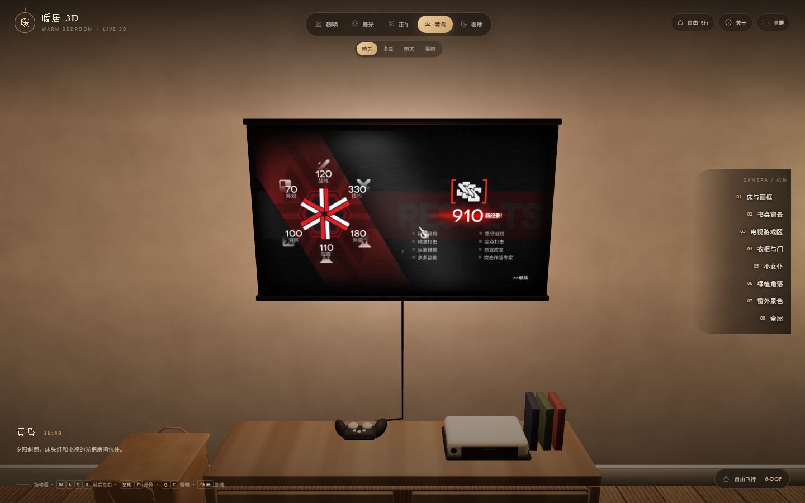
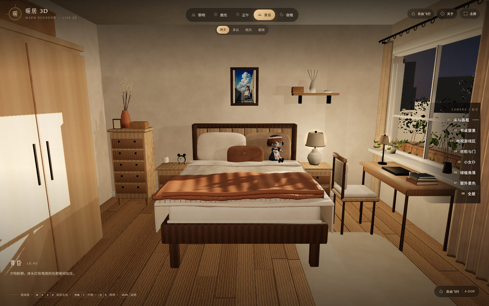

# 暖居 · Warm Bedroom v2 — Live 3D

按 **你最后修改的建模**（`warm_bedroom_v2.blend`，2026-10-20 15:54）重新烘焙的实时 3D 卧室。相机是真 **6 自由度自由飞行**（位置 X/Y/Z 含升降 + 偏航/俯仰/侧倾），不是固定机位旋转。可切换 5 个时间段与 4 种天气；雨天有实时雨粒子；窗外是真几何景观。

> **直接看**：双击 [`website/index.html`](website/index.html)。  
> **说明书**：[`README.html`](README.html)。



## 介绍片（60 秒 · 1080p · 中文字幕）

成片：[`成品/暖居卧室_介绍片_60秒_中文字幕.mp4`](成品/暖居卧室_介绍片_60秒_中文字幕.mp4)（SRT 同目录 `.srt`，可换成你自己的音乐后重新压）。

- **规格**：1920×1080 / 24 fps / H.264 / 1444 帧 / 60.17 s，**无音轨**（留给你的 BGM）。
- **渲染**：Blender 5.2 LTS · Cycles · **10 samples + OptiX 降噪**（正式出片规格，没有降采样、没有减采样）。
- **结构**：6 s 制作过程（线框 → 白模 → 点亮）+ 10 个镜头 × 5.42 s 成品展示。
- **字幕**：11 条中文，`libass` + 微软雅黑硬烧进画面。

| 段落 | 时间 | 内容 |
| --- | --- | --- |
| 制作过程 | 0.0–6.0 s | 线框（EEVEE Wireframe 材质）→ 白模（Workbench）→ 成片光照（Cycles） |
| 01 开场 | 6.0 s | 黄昏暖木色，全屋横移 |
| 02 床头 | 11.4 s | 画框装裱 + 床头灯 |
| 03 书桌窗 | 16.8 s | 晨光、1.2 m 书桌、窗台绿植 |
| 04 电视 | 22.3 s | 黄昏电视屏冷光 |
| 05 衣柜 | 27.7 s | 胡桃木双开门 + 拉手（2026-10-21 重制机位：从"门 + 衣柜"全景推近到柜门，原机位几乎不动） |
| 06 正午 | 33.1 s | 窗台绿植与半透窗纱 |
| 07 入夜 | 38.5 s | 床头灯暖黄光晕 |
| 08 暴雨 | 43.9 s | 窗外雨线、室内灯亮 |
| 09 雨天 | 49.3 s | 阴雨外景、屋内明亮 |
| 10 结尾 | 54.8 s | 回到全屋，收尾字幕 |

复现脚本全部在 `source/`：`render_prologue.py`（制作过程）、`render_intro_resume.py` + `rerender_fix4.py`（十个镜头）、`reframe_wardrobe.py`（衣柜机位重制）、`build_subtitles.py`（SRT）、`concat_video.py`（分段编码 → 拼接 → 烧字幕）、`burn_and_swap_wardrobe.py`（只替换衣柜段并重编，含字幕补烧）。

**验收记录（2026-10-21 全量复核）**

| 项目 | 结果 |
| --- | --- |
| 流结构 | 1 条视频流，无音轨；H.264 High / yuv420p / 1920×1080 / 24 fps / 1444 帧 / 60.1667 s |
| 解码完整性 | 全片解码 0 错误 |
| 剪辑点 | 场景检测 11 个切换，与设计（2.0 / 4.0 s 制作过程三拍 + 9 个镜头边界）完全一致，6.0 s 处为无缝衔接（刻意做成无切换） |
| 黑场 / 冻帧 | 无黑场；无 ≥0.4 s 冻帧（改机位前衣柜段有 0.5 s 冻帧，已消除） |
| 镜头运动量 | 每秒帧差 0.6–16，衣柜段由 0.31–0.48 提升到 0.79–1.05，与其它慢镜一致 |
| 字幕 | 11 条全部在时限内；字幕白字黑边包围盒逐像素复核，替换段与其它段 x 213–1677 / y 880–908 完全一致（字体、字号、基线同一） |
| 画质 | 未改动部分相对上一版 PSNR 46.4–46.8 dB（一次 crf16 重编，视觉无损） |

## 这次修好的四件事

1. **真自由视角** — 相机不再钉在一个平面上。桌面端：拖动看，`W A S D` 前后左右，`空格`/`C` 升降，`Q`/`E` 侧倾，`Shift` 加速，滚轮变焦；手机端：拖动看 + 左下摇杆移动 + 升降盘。位置和朝向互相独立，可以飞到任意高度、任意角度贴近细节。
2. **光照** — 黎明 / 晨光 / 正午按你 `scene_controller.py` 的预设重新调亮；电视屏幕白天不再被压成黑，保持可读；**雨天 / 暴雨会把室内灯全部打开**（雨越大越亮，暴雨约 1.8–2.3 倍），不会整屋发黑。
3. **灯位** — 书桌灯、电视光、画灯都对齐到灯具本体的真实位置：书桌灯从偏离 **13.2 cm** 改到 **0.0 cm**，电视光 **5 cm** 贴屏，画灯移到画框上方并指向画心；三盏灯都在灯罩开口下方（不再卡在灯罩里被挡住）。
4. **窗外** — 窗台花箱、花园花卉、绿篱、近 / 中景树现在都以真实几何进入 Web 模型（4096 烘焙组），加上程序化天空球、地面和城市远景。**不再挡一块板**，从窗边真的能看到屋外的层次。

## 直接看效果

| 桌面预览 | 夜晚 | 窗外 |
| --- | --- | --- |
|  |  |  |

| 暴雨 | 电视 | 全屋 |
| --- | --- | --- |
|  |  |  |

## 先看这里

- **标准以你的修改版为准**：`warm_bedroom_v2.blend`（2026-10-20 16:56 保存，898 对象 / 92 材质，两张贴图内嵌）。你改窗口的干枝 / 小瓶 / 托盘、绿帘、桌面都保留。
- **这一次我动了 `.blend` 的三处灯位**（书桌灯 / 电视光 / 画灯）——只改位置、不碰几何与材质，脚本见 `source/fix_light_positions2.py`。
- **旧网站与历史版本已清理**（2026-10-21）：v1 备份、360° 旧站、历史 `.blend` 副本、过程脚本共 **240.3 MB** 已删除，逐项清单见 [`DELETED_20261021.md`](DELETED_20261021.md)。`warm_bedroom_rain.blend` 可用 `source/add_rain_particles.py` 随时重建。
- **没有服务器依赖**：`website/index.html` 直接双击打开；`assets.js` 把 GLB、8 张烘焙贴图、画框和电视图全部内嵌，`file://` 下可运行。
- **不再糊**：关键表面（建筑 / 家具 / 女仆 / **窗外近景**）用 **4096²** 烘焙贴图，其余 2048²；实时几何在原分辨率渲染；电视和画框保留原始高清图。

## 新网站怎么玩

| 操作 | 说明 |
| --- | --- |
| 拖动鼠标 / 手指 | 自由转视角（偏航 + 俯仰） |
| `W A S D` / 方向键 | 前后左右移动；`Shift` 加速 |
| `空格` / `C` | 上升 / 下降（竖直移动） |
| `Q` / `E` | 左右侧倾（roll） |
| 右键拖动 / `Shift`+拖动 | 平移相机（不转视角） |
| 滚轮 | 视野缩放 |
| 左下摇杆 + 升降盘 | 手机 / 平板的移动与升降 |
| 右侧 8 个机位 | 床与画框、书桌窗景、电视游戏区、衣柜与门、小女仆、绿植角落、**窗外景色**、全屋 |
| `V` / 右上角模式 | 在 **自由飞行** 与 **环绕观察** 之间切换 |
| 顶部 5 个时间 | 黎明 / 晨光 / 正午 / 黄昏 / 夜晚；灯光、曝光、窗外颜色、电视亮度联动 |
| 天气 4 个按钮 | 晴天 / 多云 / 雨天 / 暴雨；雨天 / 暴雨有 3D 雨线 + 玻璃雨痕，暴雨有闪电 |
| `1–5` / `6–9` | 切时间 / 切天气；`Home`/`Z` 回床景；`X` 全屏 |

- 默认是 **自由漫游**，不是固定旋转；相机高度固定 1.58 m，位置限制在房间内。
- 右侧机位是“快速定位”，点完仍然可以继续走或环视。
- 雨天建议点“书桌窗景”，雨会从窗外落下并在玻璃上留下雨痕。

## 质量与烘焙方式

原工程的 90 个程序化材质无法直接进入 WebGL，所以按集合拆成 **7 个烘焙组**：

| 组 | 贴图 | 面数 |
| --- | --- | --- |
| Architecture | 4096² | 3,458 |
| Furniture | 4096² | 8,164 |
| Maid | 4096² | 188,100（导入前减面保留 20%） |
| Bedding | 2048² | 38,550 |
| Decor | 2048² | 16,040（移除了会读成黑点的地毯绒毛曲线） |
| Plants | 2048² | 45,932 |
| Window / curtains | 2048² | 17,842 |

- 导出为 **18.8 MB GLB**（无内嵌贴图），贴图单独烘焙为 JPEG，再由 `assets.js` 内嵌。
- 电视 `TV_Screen` 和画框 `Frame_Artwork` **不参与烘焙**，保留原始清晰图；电视在 JS 里做了水平翻转以匹配 Blender 的镜像 UV。
- 剔除：窗玻璃、纱帘、画框玻璃、旧雨幕、地毯绒毛曲线、室外场景（室外用程序化天空/城市板，避免烘焙低密度导致糊）。
- 实时灯光：窗边 SpotLight + 三盏灯 PointLight + 电视光 + 雷电闪光；PCF 软阴影；ACES 色调映射。
- 没有使用 360 全景，因此不会出现“一放大就糊”的问题。

## 雨天

### 网站

- 窗外 3D 雨线：最多 1800 条，按雨量显示；暴雨更密、更快。
- 玻璃雨痕：260 条短雨线贴在窗面，保证从床边也能读出下雨。
- 窗外程序化天空/城市板随时间与天气变暗；暴雨有随机闪电。
- 全部在 Three.js 中实时运行，不是一张雨景贴图。

### Blender 粒子版

- 会在你的最终场景副本上添加 **真实 Blender 粒子系统**（2600 个雨滴实例、发射面、重力、运动模糊），旧雨幕隐藏；另存为 `warm_bedroom_rain.blend`，不覆盖你的工程。
- 用它渲染了 [`renders_v2/hero_rain_2560.png`](renders_v2/hero_rain_2560.png)（2560×1440）。
- 复现脚本：[`source/add_rain_particles.py`](source/add_rain_particles.py)。（该 `.blend` 副本已于 2026-10-21 清理，需要时跑一遍脚本即可再生）

## 文件

| 文件 / 目录 | 说明 |
| --- | --- |
| `warm_bedroom_v2.blend` | **你的最终工程**（标准，2026-10-20 16:56 保存）；本网站几何以它为准 |
| `assets/chibi_maid_USER.blend` | 你的女仆模型源文件（保留） |
| `website/index.html` | **主站**；双击即开 |
| `website/assets.js` | 41.6 MB，内嵌 GLB + 8 张烘焙贴图 + 画框/电视图（运行时唯一数据源） |
| `website/app.js` | 6-DOF 相机、漫游/环绕、雨、灯光、UI |
| `website/libs/` | Three.js r128、GLTFLoader、OrbitControls（本地） |
| `成品/` | 60 秒介绍片 mp4 + srt |
| `DELETED_20261021.md` | 2026-10-21 清理清单（删除项、理由、体积） |
| `source/bake_web_model.py` | 从你的 `.blend` 生成 GLB + 8 张 atlas 的可复现脚本 |
| `source/build_assets_js.py` | 把 GLB / 贴图 / 画框 / 电视重新打包成 `website/assets.js` |
| `source/fix_light_positions2.py` | 把书桌灯 / 电视光 / 画灯对齐到灯具位置 |
| `source/add_rain_particles.py` | 生成粒子雨 `.blend` 版本 |
| `renders_v2/previews/` | 新网站截图：桌面 / 夜晚 / 窗外 / 暴雨 / 电视 / 全屋 |

> `source/build_bedroom_v2.py` 是**历史重建脚本**，运行会重新生成旧几何并覆盖你的修改；不要对当前 `.blend` 使用。当前导出只读 `warm_bedroom_v2.blend`。

## 可复现

```powershell
# 路径按你自己的环境改（<BLENDER> / <PYTHON> 换成实际安装位置）

# 1) 从 .blend 解出两张源图到 textures/（.blend 里的图片是内嵌的）
& "<BLENDER>" -b --python source/unpack_textures.py

# 2) 重新烘焙 Web 模型（只读 .blend，不覆盖）
& "<BLENDER>" -b --factory-startup --python source/bake_web_model.py

# 3) 重新生成内嵌 assets.js
& "<PYTHON>" source/build_assets_js.py

# 4) 浏览器打开
start website/index.html
```

> `website/assets/`（GLB + 8 张 atlas 的未打包版本）体积 31 MB，仓库里**没有**提交；
> 需要它时用 `source/restore_assets.py` 从 `website/assets.js` 无损还原（字节与原件一致），
> 或跑上面第 1–2 步重新烘焙。

## 已知取舍

- 烘焙的是 **albedo**，不是完整光照贴图；所以动态时间/天气能工作，但布料透光、玻璃折射、灯罩自发光被近似为材质颜色 + 实时灯。
- 窗外是程序化天空/城市板（不是原室外几何），以避免低密度 atlas 的糊和穿帮；原 `Outdoor` 集合仍在 `.blend` 内，只是不进入 Web 模型。
- 房间是封闭的；环绕模式把目标放在房间中心，相机可以靠近墙，但没有做家具碰撞。漫游模式限制在房间内，不会走出墙体。
- 首次打开需加载 37.5 MB 的 `assets.js`；桌面 Chrome/Edge 通常几秒，手机视设备而定。加载期间有进度遮罩。

---

Made with Blender 5.2 LTS · Cycles / OptiX · Three.js r128 · 2026-10-20
